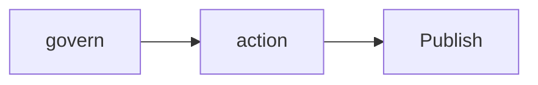
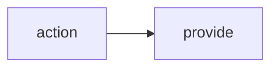
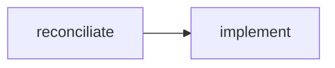
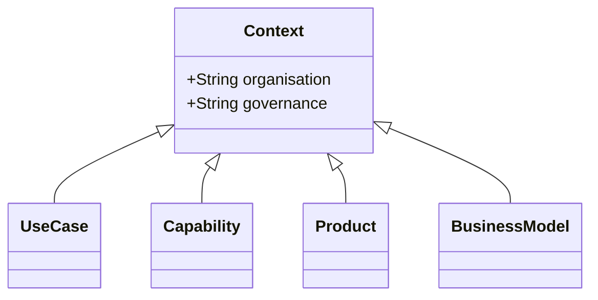
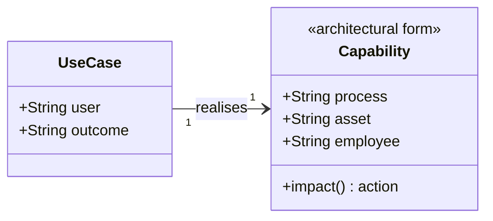
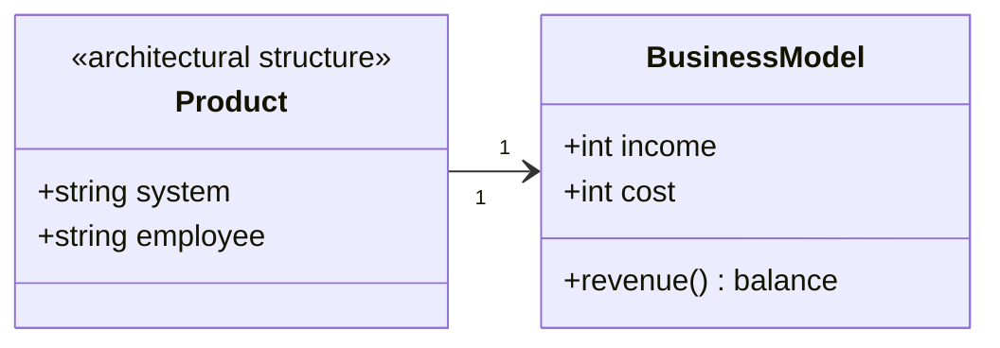

# The ABCDesEnt Architectural Pattern
This pattern is not primarily a template but rather a tool to measure, compare and judge work against, be it a use case, a process analysis or more elaborate design or architectural work.  

# How it works
tbd model here...
Mermaid syntax explained here: https://mermaid.ai/open-source/syntax/usecase.html
Mermaid editor: www.mermaideditor.io


# Overview Model
# Another model











# Use Cases
```mermaid
usecase-beta
direction LR

actor Customer("Customer")
systemBoundary "Capability"
  Checkout("Outcome")
end
Customer --> Checkout

```
