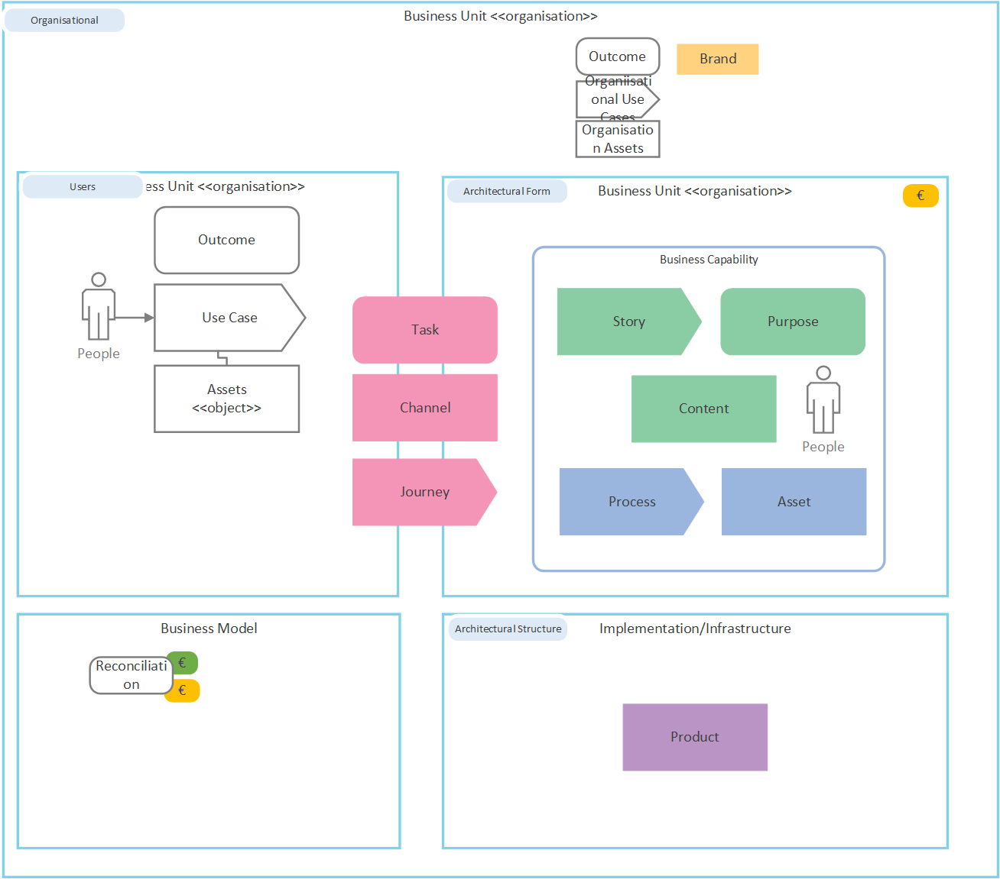
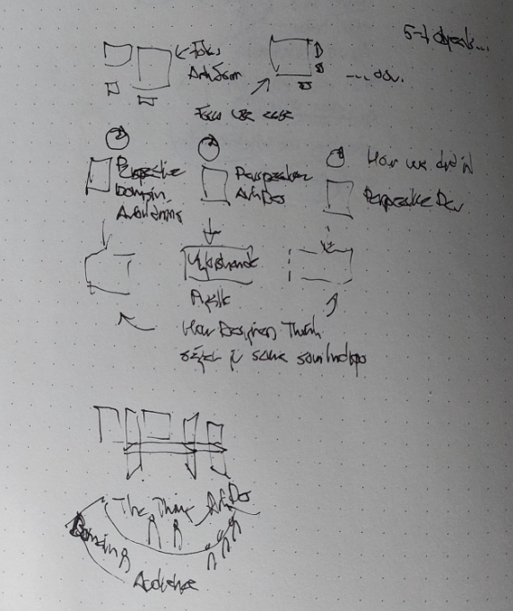

# Capabilities and Enterprise Design

This is the overall model of the capability pattern, on enterprise design level.  
It builds upon the ideas behind recursive organisations, upon DCI from Coplain and 'Capability Services' from Sundblad and on OOP with abstract base classes, polymorphism et al.  

## How to use
This model is too complex to realise different views with. Instead workable models are simplified while still containing the overall picture. E.g. when descrbining use cases, this is in focus and architectural form and structure are simplified.  Combos can also be portaied e.g. via showing a use case and how it corresponds to a feature in the business capablity.  
The recursive natuare can also be in focus, thus showin e.g. governance from organsational down to architectural strucutre, but omitting details.

## Framings
Framings are used to view the overall model from different perspecitves, such as feasability, usability or from business or technical.

## Design thinking
Design thinking can be modleed e.g via combined perspecive whre both the problem is worked on andd defined, and solution also worked on and defined. And also probe/sense by 

# Overall Pattern

Above is the overall pattern and that shows how to use.  
Besides focus on different parts, and the recursive nature.  
There are also three main perspectives based upon users.
- First it is the end user representation of their reality. On end users terms and way of viewing things. This can be in form of collage, drawings, pictures and video clips, text.
- Then it is the architecture and design which takes another form, more formal and putting 'overlays' on the end user view.
- Then it is the even more formal, development model, used to build things.  

Then there is also the design way of discovery following the Pigalle-pattern and which both defines the problem and possible solutoins, working via judgmenets and evaluating to either being finished, or persevere or pivot.  

And alstly it is the design thing, the physical representation of the design situation with vertical and horisontal surfaces where different users, team and stakeholders together have a rich environment with creative density.  
