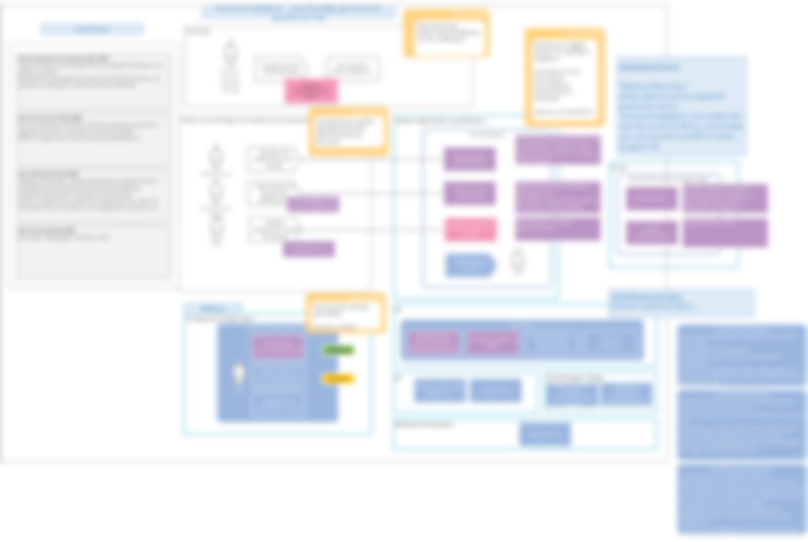
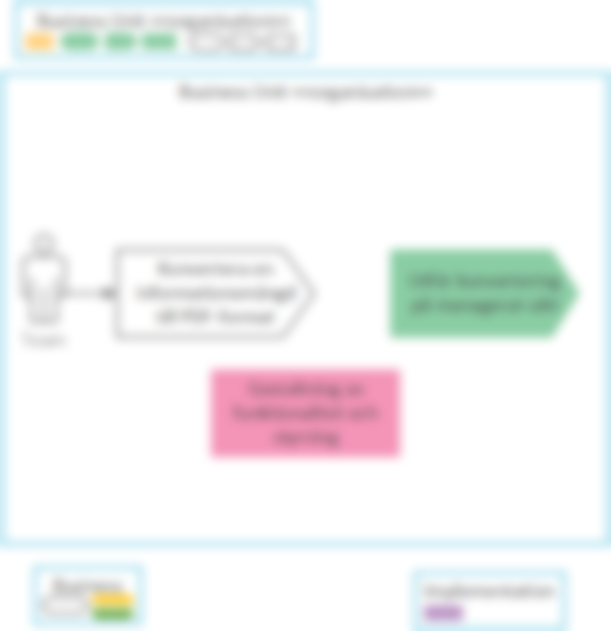

# Systemteori Systemdesign - Design av Digitala Produkter - En kortfattad manual
## tl;dr
Detta är en kortfattad manual som beskriver hur en hel verksamhet kan ses utifrån ett objektorietnerat synsätt och hur det därför kan designas genom att tillämpa systemteoretiska principer, utfört som objektorienrade system, på alla nivåer, styrning, organisation, behov, funktionalitet och hur systemutveckling/sysdev, utfört enligt OOP, kan knytas ihop hela vägen upp på detta sätt.  

## Grunden
I grunden handlar alltså designarbete om att fånga behov och realisera lösningar. När det gäller design av digitala produkter så behöver detta ske utifrån ett helhetsperspektiv, där alla olika aspekter är likvärdiga. Ett sätt är att följa arkitekturmönstret ‘ABCDesEnt’(lägg till länk t /dpdp eller internt?) som beskriver en ‘affärsförmåga’(eng. ‘Business Capability’).  
Alltså, produkten finns i ett sammanhang av användare, use case, produkten som levererar funktionaliteten som möter behovet, medarbetare som följer arbetssätt för att leverera funktionen, organisation och governance runt det som levereras, samt intäkter, kostnader inkl säljkanaler.  
Det man behöver göra är att ‘ta makten över sin lösning’ vilket innebär att börja med insikten att det faktiskt går att beskriva en digital produkt på det här sättet. Det gör att det också går att föra en konversation kring hur vi vill ha det, utifrån alla olika aspekter, användare(där vi brukar utgå från ‘Outcome’ och ‘Use Case), verksamhet(där vi brukar utgå från ’Impact' och ‘vad verksamheten vill’). Affären kan beskrivas t.ex enligt intäkt/kostnads/reconcile-modellen. Tekniken är sedan något som beskrivs som det som realiserar behov och affär, genom produkter konfigurerade så att de tillhandahåller den efterfrågade funktionen.  
Grejen är att man  inte bara kan sätta ihop produkter, teknik, arbetssätt hur som helst utan vi måste följa ‘systemdesign’-principer. Dessa finns i en rad olika sätt, nivåer, metodiker:  
- Ett utforskande sätt att fånga behov och lösningar, t.ex ‘validated learning’ via formen ‘Pigaller’.
- Kadensen som ABCDesEnt visar, alltså behov och funktion och teknisk lösning, med en organsiation och utifrån styrning och affär. Här väljer man olika perspektiv och skärningar, s.k. ‘framings’. Här har vi t.ex modellen med ‘Snowmans’ både för en förmågas alla delar och för en viktig konceptuell designnivå, den som t.ex beskriver hur förmågan ‘Konvertera’ ägs av Bevarande som också sätter governance, men kan utföras av flera, t.ex HR och på olika sätt.
  - ABCDesEnt har också uppdelningen Governance, Behov, Arkitekturell Form/Struktur och Affären.
- Snowmans kan också ställas på rad, bredvid varandra och beskriva ett systemiskt sammanhang och här behöver vi en annan uppsättning metodiker och verktyg
  - Cohesion and Coupling, som går hela vägen från governance, organsiationi och behov ner till teknik. Denna fundamentala princip går alltså igen på alla nivåer och utgör riktlinjer för hur man bör tänka när man ‘tar makten’ över sin situation och designar en upplevelse.
  - Tjänstedesign är en praktisk tillämpning av att ‘ta makten’ och designa upplevelser för både användare och verksamhet.
  - Mer specifika egenskaper som
    - ‘idempotency’ som har att göra med både teknik men också governance och arbetssätt, eller att en användare kan förvänta sig att tjänsten ger ett förutsägbart resultat.
    - ‘aggregate roots’ och ‘transactional boundaries’ som guidar i orkestrering och coupling mellan cohesive parts.

   - Domain Driven Design. Detta handlar om att man för konversationen med användare utifrån deras verklighet, deras termer(exempelvis ‘En Mera Grafisk’-modell) och gör en egen, intern designmodell, ABCDesEnt där man översätter till arkitekturella&systemdesign-termer och sätt.
    - VSM är en alternativ modell som är användbar för att ytterligare beskriva en affärsförmåga eller ‘enterprise design’.
    - ‘Intersections’, bok av Milan Guenther, även detta är en bra genomgång av hur man designar en ‘Affärsförmåga’.

 
# Prerekvisit
## Om Systemteori och vad som ofta saknas
Det finns mycket olika metodiker, verktyg, ramverk för att hantera systemteori på en strukturell nivå. Dvs, hur man skapar en helhet, hur man delar in större, komplexa system i mindre delar, hur man ser på system utifrån olika aspekter. När det kommer till aspekter börjar dock brister visa sig. Det finns två olika synsätt som grundar sig närmast i skrån. Det ena är arkitekturen som har perspektiv kring verksamhet och dess processer och aktivitet, information och dess flöden, och hur man sedan möter detta med teknik och produkter. Det andra synsättet kommer från användbarhetens skrå, personvetare, UX, tjänstedesign och som utgår från användare och vad de vill och som har mindre förståelse kring verksamheten och framför allt tekniken. Här börjar en brist visa sig.

För när man sedan kommer till systemteoretisk form, alltså hur man skall designa ett system, utifrån vilka principer så finns det inte på långa vägar lika mycket guider, manualer, verktyg. Ett exempel är Zachman vars ramverk bara är struktur, en ontologi, men nästan inget om hur man faktiskt designar ett bra system i form av en verksamhet, en produkt. Det finns dock undantag och dessa är värda att nämna, dock, det kan vara svårt att hitta mycket mer information om dessa, ofta är det äldre ursprung och som lite försvunnit till förmån för det enklare, det strukturella.

Den andra bristen är koppling till kod. I dessa dagar av AI finns en bild av att inte behöva kunna programmeringsspråk men detta är ett fel av seismisk magnitud eftersom om man inte förstår objektorienterings grunder, praktiskt i form av c++, C#, Python, Rust eller andra språk så förstår man inte att detta i grund och botten handlar om en representation av verkligheten. Det är en fundamental brist som riskerar att orsaka oöverskådlig teknisk skuld. Detta är dock något som började långt innan AI, med ‘affärsarkitektur’, vissa aspekter på ‘enterprisearkitektur’ och sedan ‘verksamhetsutveckling’ eller ‘digitala strateger’ och även från andra hållet via UX, Tjänstedesign som i vissa fall sett det som problematiskt att behöva förhålla sig till tekniken! 

Bra exempel:

- Sundblad och Sundblad. Utgår från Zachman men förenklar. Deras serie ifrån utbildningar i praktisk systemdesign är svåra att få tag på, men mycket bra. I korthet objektorientering som utgår från verksamhetens förmågor och informationsbehov. Sundblad överbryggar också en annan aspekt, den om ‘design patterns’ som utger sig för att tillhandahålla enkla mallar att fylla i, men utan förståelse kring varför, alltså inte verktyg som förstärker utan ‘Första Hjälpen’ som bara hanterar symptomen. Sundblad går inte den vägen utan visar design patterns samt hur de fungerar. En eloge.

- ‘Business Engineeering with Object Technology’, David A Taylor. Praktisk design av verksamheter, utifrån konkreta, enkla diskussioner på nivån av avdelningar inom ett företag som vem som helst kan ta till sig, och ända ner till objektorienterad kod.

- ‘Lean Architecture’, Jim Coplien. Återigen, en övergripande bild som vem som helst kan förstå och hela vägen ner till c++ och andra designmönster.
  - här finns också flera exempel på praktiska partitions, b.la architectural form vs structure, 'what the system is vs what it does', and more.

# Om arbetssätt
Vi börjar med att formulera en fråga. Kan t-ex vara ‘vad har vi för begrepp, talar vi samma språk osv.’. Men metodiker o kurser lär ofta ut att ‘allt måste förstås’ och ‘sedan går vi neråt i modellen’ osv. Erfarenhet och designtänkadne visar ngt annat. Detta funkar sällan bra utan risk för analysis paralysis som är ett designteoretiskt anti-pattern/coding horror. 

Istället, börja med att formulera en fråga. Sätt upp den i validated learning-form, t.ex Pigaller. Dessa ger då automatiskt att man går från den konrketa frågan, som kan formuleras utifårn ‘true’-begrepp vidare via ‘the real’ alltså att bygga praktiska prottyper så att svaret istället blir en utvärdering/judgement av ‘the ideal. Detta är enda sättet. detta leder oftast till en T-Shape som skär ner mot praktiska försök, leverans iterativt och inkrementellt och enligt MVP’er vilket erfarenhetsmässigt är mycket effektivare. Praktiska sätt här är att vidga begreppet, vilket också är enlidgt designteori och diverge, så att man inte bara ser begreppstabeller isolerat utan i dess sammanhang, återigen enligt ABCDesEnt t.ex. 

Metodiker bygger oftast också på planering, precis som projektledning, emn behöver erfarenhetsmässigt vändas å, så tilläma ‘the Flipped’. altlså med en viss takt/när det behjövs, do exam/reflect/demo, och ‘judgement’ och ta ut ny riktning som bara är ‘persevere’ eller ‘pivot’. 

Sedan behövs en slags ordnad metodik men denna skall hållas enkel och som separata verktyg man plockar fram, ffa i the Flipped. Börja inte enlitg en metodi som säger Top Down o en sakt i taget osv. utan

En övergrpande modell som visar systemgränser och vad som finns u tanför

Börja de-composition/chunking, hitta de stora delarna. Gör en ansats och gör sedan examen. Inte analys o förstå allt utan bygg ngt praktistk o prova på de som vet, verksamheten, använd deras språk och gör påtryck för eget bruk.

Erfarenhetsmässigt är det nästan alltid så att det finns vissa subsystem som flyter upp i konversationen, i detta projetk har det varit Lastbryggan och Konvertera. Adnra återkommande har varit Extract samt Orkestrergingt av helhheten. Dessa är bra ingångar, resten faller ut i form av ‘anti space’(fel uttyrck kmomer inte på vad det heter nu, alltså whitespace som ger en kontrasterande kontur mot det vi vet. 

# Om kadensen
För att ta sig igenom en 'enterprise capability' så var Zachman tidigt ute med att se en verksamhet som en ontologi, alltså att kunna namnge och föra en konversation kring vad som bygger upp en verksamhet. Något som Sundblad & Sundblad sedan gjort mera arbetsbart.    
Detta används sedan av arkitektur jämte andra arbeten kring en verksamhets egenskaper, vilket Zachman beror men andra utvecklat.  
Detta gär att när man tar sig från de översta lagren, som nytta, mål, governance, organisation hela vägen ner till produkter och system och kod, så finns en given form av olika lager och aspekter.  
Att ta sig genom dessa på ett säkerställt sätt, så att allt hänger samman, är arbetsbart, att rätt frågor ställs kan ses som 'en cadence', en väg genom kartan som beskriver verksamheten.  
Exempel på detta är '7 Core Maps' från Intersections (tbd länk t webinar) eller principerna om 'Viability, Feasability, Usability' men det finns många andra.  

## Om framings
Framings innebär en variant av att adressera hur man tar sig igenom kadensen och utgår ifrån att man sätter upp ett visst perspektiv. Detta kallas också 'viewpoint'. Det kan t.ex vara 'hur säkerställer vi juridiskt att en informationsägare kan lämna ifrån sig ett dokument för konvertering'. Det kan också vara icke funktionella krav kring prestanda eller säkerhet.  

# Om Konversationen
Det talas emellanåt om ‘Rosettastenen’ som ett sätt att överbrygga kommunikationssvårigheter i verksamhetsutveckling. Det är åt rätt håll, att erkänna problemet med kommunikation men risken är att det blir en för grund modell. Konversationer har inte bara med språk att göra. För att ta Rosettasteen som exempel så var ett av de tre spårken ‘klassisk grekiska’. Det finns dels varianter av klassisk grekiska, som t.ex Koine men framför allt är orden, som vi ofta refererar till när vi tänker i en Rosettasten, allt utan särskilt i grekiskan är verbformer och substantivbestämningar och inte minst kulturen runt, varöfr man hade t.ex ‘aorist’ av avgörande betydelse. Det är alltså något mer som behövs även om att ha samma termer en bra början. Ett annat bra exempel är konceptet kring ‘lingua franca’ som även det är något mer än bara orden och ett annat koncept än Rosettastenen. ytterligare ett bra exempel är ‘Mandarin’ som både är ett språk och ett helt skikt av intressenter, i våra dagars verksamheter närmast beställare, middle management och som har mycket gemensamt med det kinesiska konceptet, om b.la meritokrati som ofta slår över i en ‘hiearchial’ eller ‘pathological’ organisationstyp (efter Westrum). 

I konversatoinen är det erfarenhetsmässigt tre loopar, som återkommer i olika konversationer. De ser ut ungefär som

O  

    O  
     
      O  

ohc i konversationen kring behov och lösgninar, alltså designarbete en loop mot kunder, avnändare, beställare, sedan en loopp internt i designteamet och sedan en loop mot utvecklingsteamet, build or buy. En annan konversation också med ungefär tre loopar är gentemot projektledning, med mera stirkt projektledning som går över i att designteamet mera försörjer med underlag, och genomgående handlar det om frihet i alla olika dimensioner, alltså åter till systemteori, väl avgränsade funktionella delar och tydliga gränssnitt som ger low coupling.

## Exempel - Dokumenthantering
Vi kommer använda ett genomgående exempel i form av informationshantering och har här en del av detta, hur dokument hanteras.  
Tidigt i projektet görs alltså (har nog missat att visa detta i systemteori ovan... så tbd) görs en ‘Stadsplan’ och en modell över hur det projekt man arbetar med, relaterar till Projektledning. Senare etablerades också i projektet ‘DPoM’-gränsen, alltså en gräns mellan projektledning och designarbete. (tbd länk eller bild här)

Från Stadsplanen behöver man detaljera för att förstå mer, från det översiktliga flödet och användandet, hur just denna speficika affärsförmåga behöver etableras, givet de olika ingående aspekterna. Två sådana förmågor kommer i vårt exempel tidigt upp och fiktivt i vårt team har dessa hela tiden också varit föremål för konversationen inom teamet, mot hur andra gör, kring behov hos kunder. Dessa är ‘Hur tar vi emot ett dokument för hantering', detta har med juridiskt överlämnande, en verksamhet har tagit fram, skall information/dokument hanteras av en separat affärsenhet har detta med b.la juridiska aspekter att göra. Det andra är ‘Hur hanterar vi ett dokument' dvs i första hand, lägg till metadata o i andra hand kan konvertering behövas. Båda dessa ingår inom det projekt vi scopat in. 

## Designprincip - Decomposition/Chunking och 'Cohesion'

(Bilden är pixlad pga avidentifiering, ny bild kommer)

Detta illustrerar de två första designprinciperna från systemteori:
- 'Decomposition' innebär att större komplexa system hanteras i mindre delar.
- 'Partitioning'. Dessa delar behöver då följa någonslags princip i hur man väljer dessa mindre delar, man kan dela upp utifrån vilken aspekt eller framing som helst, kronologisk, tematisk osv.
- 'Cohesion' är dock det sätt som systemteori förespråkar. Alltså man partitionerar sitt system utifrån 'sammanhållen funktionalitet' eller 'del som utför en avgränsad funktion’ eller i viss mån ‘utgör ett naturlig delsystem’. Låg 'cohesion' innebär att delsystemet utför flera saker eller är spritt på flera andra delsystem. High cohesion är tvärtom, och det man eftersträvar.   

Vilka dessa funktioner är beror på de olika aspekter som vi väljer att beskriva systemet utifrån. I vårt fall är det affärsförmågan med Användare och behov, Funktionalitet osh sätt att leverera detta, Teknisk lösning, Styrning, Organisation och Affärsmodell. I det här fallet väljer vi att utgå från ‘Användare och deras behov’ eftersom det följer ännu en princip inom systemteori, den om stabilitet. Det mest stabila i ett system är dess information och det näst mest stabila är dess användande & syfte. Detta är den skärning vi använder, men vi kunde givetvis använt vilken annan som helst, t.ex Organisation eller Affärsmodell, men som vi skall se senare, det är bättre, för att reducera antalet konversationer och modeller/underlag, tar vi affären som en ‘Framing’, inte ett ‘Perspektiv’.  

Referenser:  
- 'Chunking'(se 'Business Engineering with Object Technology' kap 'Managing scale' page 25)
- 'Partitioning' (se 'Lean Architecture' kap 5.2 med en rad exempel på skärningar, 'what the system does vs is' m.fl.

## En första förenkling

(Bilden är pixlad pga avidentifiering, ny bild kommer)  

För att kunna föra en meningsfull konversation så behöver vi reducera komplexiteten från den första nedbrytningen enligt ovan. Här finns nu en arbetsbar aspekter och som samtidigt befinner sig i ett meningsfullt sammanhang. Den aspekt vi valt är i form av en ‘framing’ som vi här valt enligt ‘Användare och behov’ och mera specifikt, konvertering enligt exemplet kring dokumenthantering. När man väljer hur man skall börja modularisera och förenkla är ett sätt att börja från början, men ett bättre sätt är att lyssna på teamet, vad är det för stora behov och lösningar vi diskuterar, sådana brukar alltid finnas. Om de också är illustrativa, bra exempel är det ytterligare en fördel.  
Här behöver vi nu i detta exempel föra konversationen kring vilken typ av konvertering det kan röra sig om, alltså förstå mer om behovet.  

Den konversation vi alltså för här är utifrån en begränsad del men som följer designprinciperna dels om ‘cohesion’ men också ‘use-cases motsvaras alltid av en funktionalitet’ och även designmönstret som säger att en funktion utförs av en förmåga. Vi har även med ‘Business’ i ögånvrån, och i det här fallet reducerat i konversationen till ‘Use case är det enda som går att sälja’.

På det här viset kan vi alltså skapa flera sådana här förenklade vyer, men som hela tiden har med helheten och ändå är arbetsbara utifrån sin enkelhet. Arbetet går framtå genom att vi beskriver hur vi vill att sätt skall vara, vi kan skissa på tekniska lösningar, diskutera styrning och hur den utförs, eller skärpa till use-caset utifrån t.ex form av infomraiton eller juridik kring sätt som information hanteras, att rätt konvertering utförs. 

## Sammanhang
När vi sedan skapar flera sådana här del-konversationer genom att t.ex lägga till Lastbryggan kan vi också börja tala om ytterligare en designprincip, ‘low coupling’ vilket har med både mera teknisk design och ‘mental models’ att ögra, och ‘idempotency’ vilket innebär förutsägbarhet och kända state. Ännu en nivå på konversation.  
Det som behövs är alltså också ett sammanhang som visar hur den del vi valt, ingår i en hel värdekedja, för dokumenthantering kan det t.ex forstätta med publicering och uppåt, eftersom 'enterprise capabilities' också omfattar governance så är även detta viktigt att ha med. Denna sammanhangsbild kan då återigen utföras mcyket enkelt, bara som konturer, detaljer kring vad behöver inte finnas med utan bara 'att governance finns med' och i bilden ovan symboliseras detta av att ABCDesEnt-mönstret har med governance som de gula och gröna elementen(i Edgy) men här bara som små symboler.  

# Down to the metal
Design av digitala produkter omfattar alltså hela verksamheten och detta modelleras i form av Enterprise Capabilites enligt systemteoretiska och objektorienterade principer. När digitala produkter skall realiseras hamnar man till slut i någon form av systemutveckling och här beskriver vi därför hur hela vägen, från begrepp och företeelser på hög nivå, som verksamhetens nytta och mål, governance och organisation via användare, behov och funktionalitet som levereras av ett team och dessa medarbetare.  
Här förljer därför exempel på hur objektorienterade system faktiskt ser ut, i form av c++.

<tbd exempel här, men skall nog läggas som ref isf löpande text som blir för svåröverskådligt?>

# Utforskande
Arbetet behöver utföras utforskande. Dvs konversationerna får en tydlig beskrivning och ansatser som hela tiden provas praktiskt. Lösningar ger mer information om behovet, så den följer ‘Indigo-principen’.  
Läs mer om det i 'way of working, a manual'.
 
# Enterprise Capabilities
Man talar ofta om affärsförmågor, 'Business Engineering with Object Technology'(David Taylor), men ett bättre sätt är att utgå från hela verksamheten, 'Enterprise Capabilities' och 'Enterprise Design'(Milan Guenther, Edgy, Intersections)

# Begrepp vi kommit i kontakt med så här långt
- System och Delsystem - Används för att reducera komplexitet och föra en konversation av en sak i taget. System i sig följer också designprincipen om att dela upp och gör det i ‘element’ se nedan.  
- Affärsförmåga - Detta är ett systemteoretiskt byggblock, enligt Jim Coplain(Lean Architecture), Stafford-Beer(VSM) et al. som på ett tillräckligt brett sätt är arbetsbart.  
- Element - Detta är de delar som bygger affärsförmågan, enligt Edgy och Intersections(Milan Guenther).  
- Viewpoint - Detta är ett perspektiv, ett sätt att betrakta, eller att fokusera ifrån när man betraktar en affärsförmåga och har en konversation kring den. Normalt utgår man från ‘element’.  
- Cohesion - Sammanhållenhet hos ett delsystem eller delsystem. Hög cohesion innebär att en singulär funktion utförs. Detta utifårn designprincipen om ‘Separation of concern’.  
- Framing - En specifik frågeställning utifrån egenskaper.  

# Referenser
- 'Domain Driven Design'(Evans) Denna bok kan sägas börja lägga grunden för'Enterprise Capabilities', genom att beskriva hur man modellerar en verksamhet enligt OOP.
- 'Business Engineering with Object Technology'(Taylor) Denna bok har faktiskt en helhet kring hur man tänker sig en hel verksamhet utifrån ett objektorienterat sätt.  
- Intersections(Guenther) Denna bok beskriver även ramverket EDF och som sedan blivit ramverket Edgy. Den beskriver främst ontologin för att beskriva en 'enterprise capability' om än inte så mkt kring metodiker.
- 'Lean Architecture'(Coplien) Tillsammans med DCI-konceptet(Renskjaug) och Sundblad en helt avgörande text för att förstå hur man realiserar objektorienterade enterprise capabilities.
- 'Sundblad & Sundblad' tbd länk här till läsbart material.
- OOUX. Detta är en metodologi som bryggar över designspåret mot objektorientering.  

